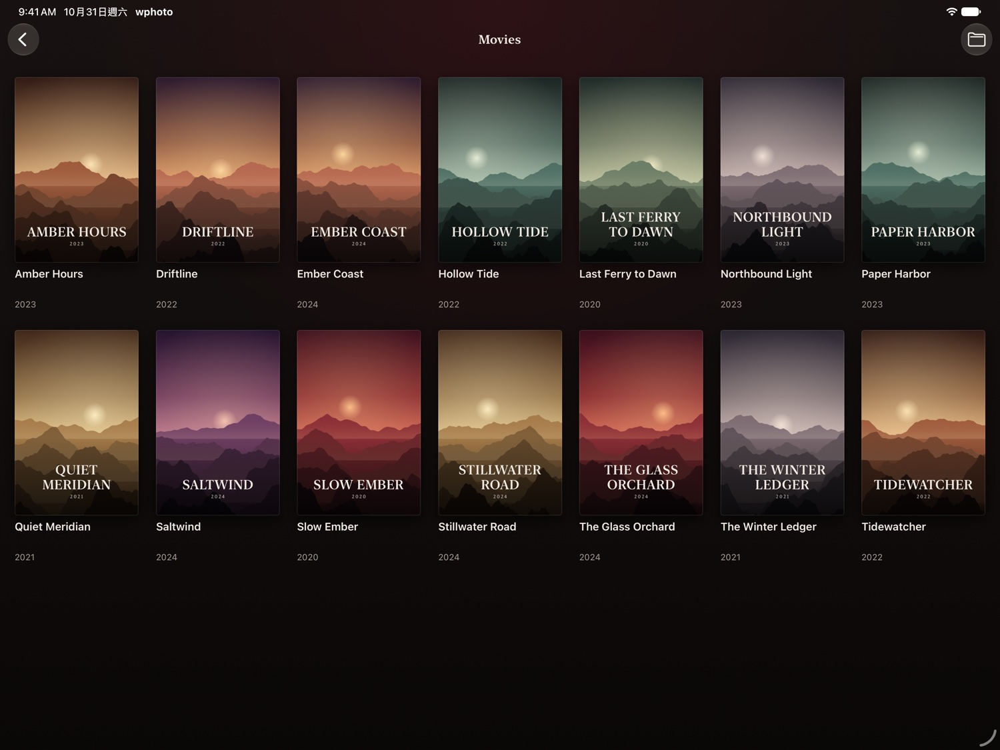
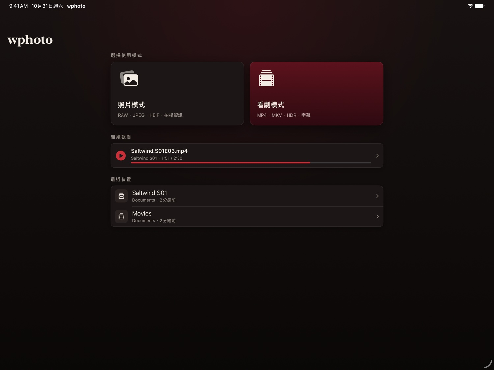
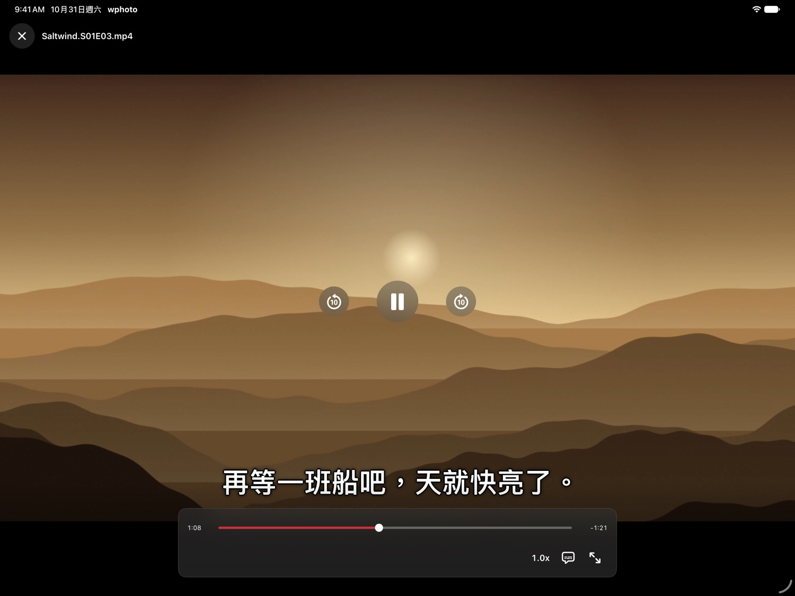
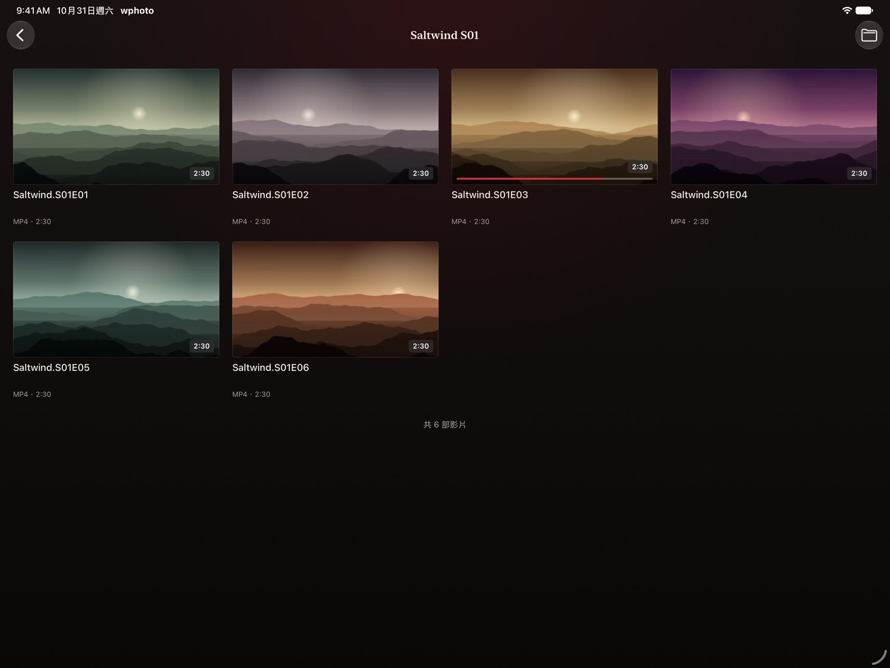
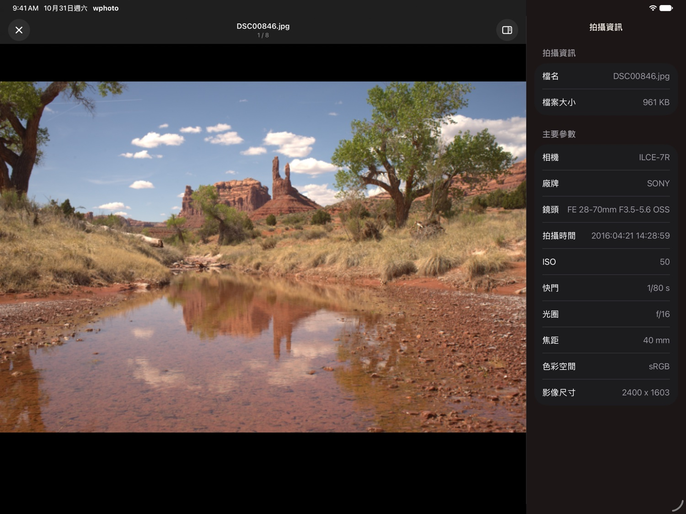
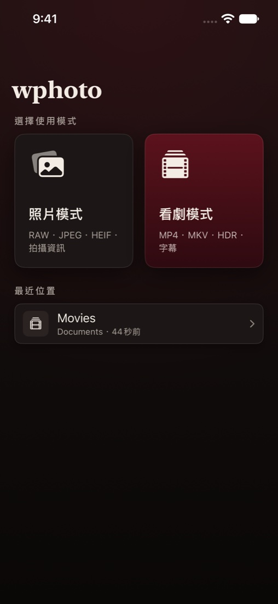
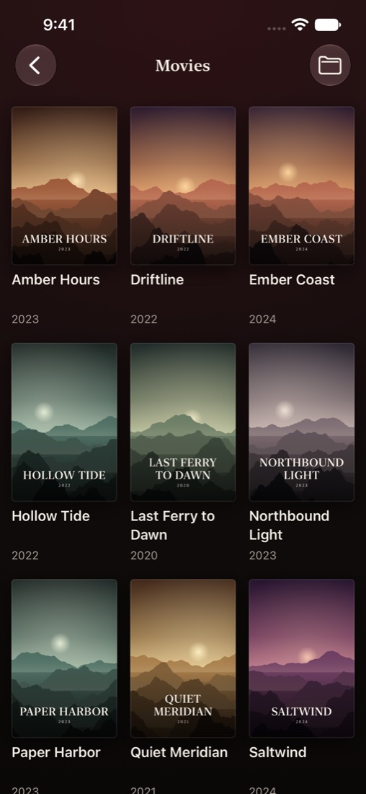

# wphoto

**A fast RAW photo viewer and a home theater for your own video library, on Windows, iPhone, iPad and Mac.**
Opens an 80 MB RAF in a blink by reading the camera's embedded full-size preview, and plays 10-bit H.265 MKV without installing a single codec.

**極速 RAW 看圖工具，加上你自己影片庫的家庭劇院，支援 Windows、iPhone、iPad 與 Mac。**RAW 秒開、4K HEVC 直接播，免裝解碼器。



| Platform · 平台 | Get it · 取得方式 | Source · 原始碼 |
|---|---|---|
| Windows | [Download from Releases](https://github.com/alextixu/wphoto/releases) | Repository root · 根目錄 |
| iPhone · iPad | Build with Xcode, or sideload · [Install guide](ios/README.md#install-on-your-iphone--安裝到-iphone) | [`ios/`](ios/) |
| Mac (Apple silicon) | Run the iPad app from Xcode as "Designed for iPad" | [`ios/`](ios/) |

**UI in your language** — Traditional Chinese, Simplified Chinese, and English. The iPhone app follows your system language; the Windows app detects it and lets you switch anytime.
**三語介面**——繁體中文、简体中文、English。iPhone 版跟隨系統語言，Windows 版自動偵測，也可以隨時切換。

## iPhone, iPad & Mac · iPhone、iPad 與 Mac 版

| Home · 首頁 | Player · 播放 |
|---|---|
|  |  |
| **Episodes · 集數** | **Shooting info · 拍攝資訊** |
|  |  |

<p align="center">
  
  &nbsp;&nbsp;
  
</p>

- **Cinema-style interface** — warm black with a single velvet red accent, so posters and photos are the brightest things on screen
- **Poster wall** — movie folders appear as 2:3 posters with title and year, using your `poster`, `folder`, `cover` or `fanart` image
- **Continue Watching** — both players resume where you stopped, and the home screen lists unfinished videos and recent locations
- **Plays almost anything** — MP4 and MOV through AVPlayer keep HDR, Dolby Vision, Picture in Picture and AirPlay; MKV, AVI, TS, WebM and more play through VLCKit
- **Subtitles that fit any screen** — text scales with the picture from a phone to a 4K display, with dual subtitles and embedded MKV text tracks
- **Stays awake while you watch** — the screen stays on during playback and long downloads, and sleeps normally when paused
- **RAW and HEIF photos** — thumbnail grid, pinch to zoom with full-resolution reload, and a full shooting info panel
- **Folders from anywhere in Files** — iCloud Drive, on-device storage, or a NAS connected in the Files app

Full details, player selection and subtitle rules are in [`ios/README.md`](ios/README.md).

<details>
<summary>中文功能說明</summary>

- **電影院風格介面**：暖黑配單一絨布紅，讓海報和照片成為畫面上最亮的東西
- **電影海報牆**：電影資料夾以 2:3 海報呈現，顯示片名與年份，封面取自 `poster`、`folder`、`cover` 或 `fanart`
- **繼續觀看**：兩種播放器都會記住看到哪裡，首頁列出看到一半的影片與最近位置
- **幾乎都能播**：MP4、MOV 走 AVPlayer，保留 HDR、杜比視界、子母畫面與 AirPlay；MKV、AVI、TS、WebM 等走 VLCKit
- **任何螢幕都清楚的字幕**：字幕隨畫面等比例縮放，從手機到 4K 都適用，支援雙字幕與 MKV 內嵌文字字幕
- **看片不休眠**：播放與長時間下載時螢幕不會自動關閉，暫停後恢復正常休眠
- **RAW 與 HEIF 照片**：縮圖牆、捏合縮放並重新載入完整解析度、完整拍攝資訊面板
- **從「檔案」開啟任何位置**：iCloud 雲碟、本機，或在「檔案」App 連接的 NAS

完整說明、播放引擎選擇與字幕規則請看 [`ios/README.md`](ios/README.md)。

</details>

## Windows · Windows 版


Two modes at startup · 啟動時選擇模式：


### Photo mode · 照片模式

- **20+ RAW formats** — RAF, ARW, CR2/CR3, NEF, DNG, ORF, RW2 and more (via LibRaw). Embedded-preview fast path, full decode as fallback
- **JPEG / HEIF (.HIF)** — every Fuji / Sony still format, HEIF decoded without system extensions
- **Full shooting info panel** — camera, lens, ISO, shutter, aperture, focal length, exposure mode, GPS…
- **Zoom & pan** — mouse-wheel zoom up to 1000%, drag to pan, double-click to reset
- **Thumbnail gallery** on folder open — RAW embedded previews appear in a blink, click any to view
- **Recursive folder scan** with file-type filter (only shows types that actually exist in the folder)

### Theater mode · 看劇模式

- **Episode picker with covers** — open a whole season folder and pick an episode from a thumbnail grid (Netflix-style)
- **Plays everything** — MP4 (XAVC S/HS), MOV, MKV, MTS/M2TS (AVCHD), AVI, MXF via bundled LibVLC; 10-bit H.265 / Dolby Vision files just work
- **Subtitles** — switch embedded subtitle tracks, auto-loads external .srt/.ass/.ssa/.sub/.vtt from the folder (incl. `Subs` subfolder)
- **Full playback controls** — seekable progress bar, playback speed 0.5x–2.0x, play/pause
- **YouTube-style fullscreen** — true edge-to-edge, controls auto-hide when idle and reappear on mouse move

<details>
<summary>中文功能說明</summary>

**照片模式**
- 20+ 種 RAW 格式（RAF、ARW、CR2/CR3、NEF、DNG…），優先讀內嵌預覽、秒開大檔
- JPEG / HEIF (.HIF) 全支援，HEIF 不需系統擴充
- 完整拍攝資訊面板：相機、鏡頭、ISO、快門、光圈、焦距、GPS…
- 滾輪縮放（最大 1000%）、拖曳平移、雙擊還原
- 縮圖牆：開資料夾先看縮圖總覽（RAW 取內嵌預覽，秒出），點選檢視
- 遞迴掃描子資料夾、依類型篩選

**看劇模式**
- 封面選集畫面：選整季資料夾後用縮圖卡片挑集數
- 內建 LibVLC：MP4、MOV、MKV、MTS/M2TS、AVI、MXF 全都能播，10-bit H.265 免裝解碼器
- 字幕：內嵌字幕軌切換、自動載入同資料夾（含 Subs）的外掛字幕
- 進度條拖曳跳轉、0.5x–2.0x 倍速、播放/暫停
- YouTube 式全螢幕：完全滿版、控制列閒置自動隱藏

</details>

### Playback capabilities · 播放能力與限制

Everything mainstream opens and plays — the limits below are about *presentation quality*, inherited from the LibVLC 3 engine (same as VLC itself):

| Video | Status |
|---|---|
| H.265/HEVC 10-bit, 4K high-bitrate | ✅ Full support (hardware-accelerated + software decode) |
| HDR10 | ⚠️ Plays, tone-mapped to SDR for display |
| HDR10+ | ⚠️ Dynamic metadata ignored, treated as HDR10 |
| Dolby Vision (hybrid, with HDR10 base layer) | ✅ Plays via base layer |
| Dolby Vision Profile 5 (no base layer) | ⚠️ Known LibVLC 3 color-shift issue (purple/green tint) |

| Audio | Status |
|---|---|
| DD+ (E-AC-3), AC-3 | ✅ Full decode |
| TrueHD, DTS-HD MA | ✅ Decodes |
| Dolby Atmos | ⚠️ Core 5.1/7.1 only — the object/height layer is ignored; downmixed to your output device |

<details>
<summary>中文說明</summary>

主流最高規格的檔案**都播得開**，以下限制是「呈現品質」層面，繼承自 LibVLC 3 引擎（與 VLC 播放器相同）：

- **H.265 10-bit 4K 高碼率**：完全支援（硬體加速＋軟解）
- **HDR10 / HDR10+**：可播放，但會 tone-map 成 SDR 顯示；HDR10+ 動態 metadata 忽略
- **Dolby Vision**：Hybrid（帶 HDR10 底層）正常播；純 Profile 5 檔案有 LibVLC 3 已知的紫綠色偏問題
- **DD+ / AC-3 / TrueHD / DTS-HD MA**：正常解碼
- **Dolby Atmos**：只解核心 5.1/7.1 聲道，天空聲道物件層忽略，依輸出裝置下混

</details>

### Download · 下載

Grab the latest zip from [Releases](https://github.com/alextixu/wphoto/releases), unzip, run `wphoto.exe`. No installation, no .NET runtime, no codecs required.

從 [Releases](https://github.com/alextixu/wphoto/releases) 下載 zip，解壓縮後直接執行 `wphoto.exe`，免安裝、免 .NET、免解碼器。

### Keyboard & mouse · 操作

| Action | Input |
|---|---|
| Next / previous file | `↑` `↓` (photo mode also `←` `→`) |
| Zoom photo | Mouse wheel |
| Pan (when zoomed) | Left-drag |
| Reset zoom | Double-click |
| Play / pause video | `Space` |
| Seek −10s / +10s | `←` `→` |
| Fullscreen | `F11` (exit: `Esc`) |
| Episode picker | 「選集」 toolbar button |
| Open folder | Button, or drag & drop a folder onto the window |

### Build from source · 從原始碼建置

```
dotnet build PhotoViewer
```

Release build (folder publish + ReadyToRun; produces `dist/wphoto_v<version>_win-x64.zip`):

```
.\publish.ps1                      # zip only
.\publish.ps1 -Install E:\wphoto   # also copy to a folder you can pin to the taskbar
```

Why a folder instead of a single-file exe: a 438 MB single file must be read completely on every cold start — 20 s on a laptop HDD. The folder build starts in ~3 s cold / 0.6 s warm.

## Repository layout · 專案結構

Everything lives on `main`. The Windows and iOS apps are separate projects that share no code, so each builds on its own.

所有程式碼都在 `main`。Windows 版和 iOS 版是各自獨立的專案，沒有共用程式碼，可以分別建置。

```text
.
├── *.cs, *.xaml, PhotoViewer.csproj   Windows app (.NET 9, WPF)
├── publish.ps1                        Windows release script
├── ios/                               iPhone, iPad and Mac app (SwiftUI)
├── docs/                              Screenshots and maintainer notes
└── .github/workflows/                 iOS build checks
```

## Tech stack · 技術

**Windows**

- .NET 9 / WPF + [WPF-UI](https://github.com/lepoco/wpfui) (Fluent)
- [Sdcb.LibRaw](https://github.com/sdcb/Sdcb.LibRaw) — RAW decoding (LibRaw)
- [MetadataExtractor](https://github.com/drewnoakes/metadata-extractor-dotnet) — EXIF
- [LibVLCSharp](https://github.com/videolan/libvlcsharp) — video playback (LibVLC, LGPL-2.1; shipped as separate DLLs)
- [Magick.NET](https://github.com/dlemstra/Magick.NET) — HEIF decoding

**iPhone, iPad & Mac**

- SwiftUI, with AVFoundation and ImageIO for Apple's native photo and video decoding
- [MobileVLCKit](https://code.videolan.org/videolan/VLCKit) — playback of MKV and other non-Apple formats (libVLC, LGPL-2.1)

## License · 授權

[MIT](LICENSE). Video playback uses LibVLC under LGPL-2.1, distributed as separate dynamic libraries. iOS uses VLCKit under the same license.

Sample photos in the screenshots are CC0 from [raw.pixls.us](https://raw.pixls.us). The posters and video frames in the iOS screenshots were generated for this README, and the titles are fictional.
